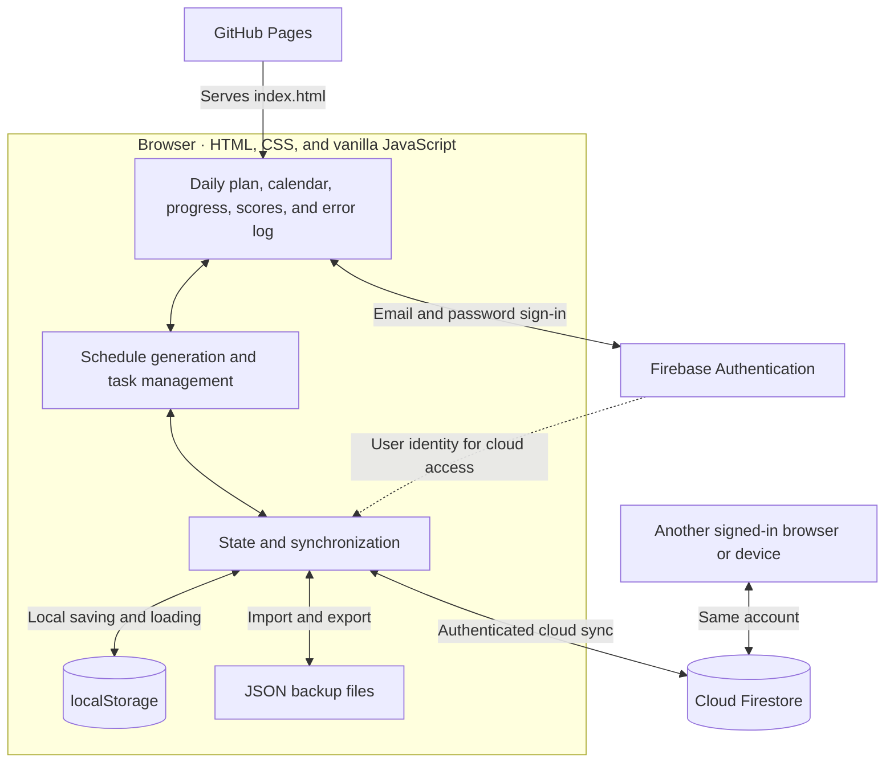
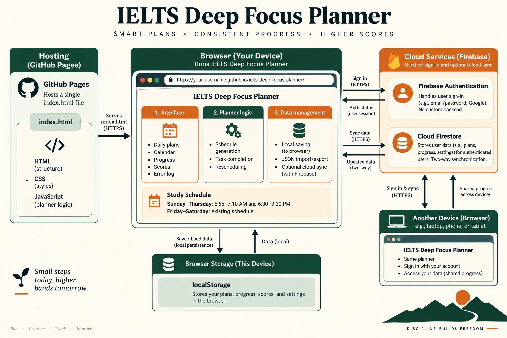

# IELTS Deep Focus Planner

A responsive, single-page IELTS study planner for a Band 8.0 target. It provides a 74-day study schedule from **1 September to 13 November 2026**, ahead of the **14 November 2026** exam, with task tracking, diagnostic priorities, practice-score history, an IELTS error log, calendar navigation, offline storage, JSON backups, and optional Firebase synchronization across browsers and devices.


## Live site

[Open the IELTS Deep Focus Planner](https://saydur-007.github.io/ielts-deep-focus-planner/)

## Features

- Structured daily Listening, Reading, Writing, Speaking, Grammar, Vocabulary, Mock, and Review tasks
- Morning and evening study blocks
- Required-task progress, weekly completion rate, streak, and days remaining
- Baseline diagnostic and editable module priorities
- Estimated IELTS score tracker and trend display
- Structured central Error Log with filters and review status
- September–November 2026 calendar
- Move or skip unfinished tasks without overloading normal study days
- Local offline persistence through `localStorage`
- Export and import of planner data as JSON
- Secure Firebase Authentication and Firestore synchronization
- Responsive layout suitable for desktop, mobile, and a Notion embed

## Technology

The application is contained in [`index.html`](./index.html) and uses:

- HTML, CSS, and vanilla JavaScript
- Firebase Authentication with email and password
- Cloud Firestore for cross-device synchronization
- Firebase browser modules loaded from Google's CDN
- GitHub Pages for hosting

No package installation or build step is required.

## Study schedule

| Days | Morning | Evening |
| --- | --- | --- |
| Sunday–Thursday | 5:55–7:10 AM (75 minutes) | 6:30–9:30 PM (180 minutes) |
| Friday–Saturday | 8:00–11:30 AM (210 minutes) | 7:00–9:00 PM (120 minutes) |

The Sunday–Thursday hours apply throughout the plan. Morning work exceeding 75 minutes continues in the evening, preserving the day's total planned study time. Friday and Saturday retain their existing tasks and hours. Catch-up suggestions use these block capacities when checking available time.

These windows show available study time; the **Planned** summary shows the total duration of assigned tasks, which may be shorter.

## Architecture

The application runs in the browser. GitHub Pages serves `index.html`, which contains the interface, schedule generation, task tracking, storage, and cloud synchronization logic.



| Component | Responsibility |
| --- | --- |
| Interface | Displays study blocks, tasks, calendar, progress, scores, and the Error Log. |
| Planner logic | Generates dated plans, adjusts weekday task blocks, and finds space for catch-up work. |
| Local persistence | Saves progress and user-entered data in browser `localStorage`. |
| JSON backups | Exports and restores planner data manually. |
| Firebase Authentication | Signs users in with email and password for cloud access. |
| Cloud Firestore | Stores account-specific planner state at `users/{userId}/planner/state`. |

Task changes update local state and storage, then schedule a cloud save when signed in. A Firestore listener receives changes from other devices. Synchronization compares state timestamps; newer state replaces older state, with an initial merge for existing local data without a sync timestamp. Simultaneous edits on multiple devices can overwrite older changes because ongoing synchronization operates on the whole planner state.



## Run locally

Opening `index.html` directly works for most offline features. For reliable browser-module loading, run a small local web server:

```bash
python3 -m http.server 8000
```

Then visit `http://localhost:8000`.

## Firebase setup

The Firebase project configuration is included in `index.html`. Complete the following console setup before using cloud synchronization.

### 1. Enable authentication

In Firebase Console:

1. Open **Authentication → Sign-in method**.
2. Add **Email/Password**.
3. Enable the first Email/Password option and save it.
4. Open **Authentication → Users** and create the account that will be used on every device.

Google sign-in is not required by the current application.

### 2. Add authorized domains

Open **Authentication → Settings → Authorized domains** and add:

```text
saydur-007.github.io
```

Add `localhost` as well if it is not already listed and local authentication testing is needed.

### 3. Create Firestore

1. Open **Firestore Database**.
2. Create a **Standard edition** database.
3. Keep the database ID as `(default)`.
4. Choose an appropriate nearby region.
5. Select **Production mode**.

### 4. Publish security rules

Open the Firestore **Rules** tab and publish:

```text
rules_version = '2';

service cloud.firestore {
  match /databases/{database}/documents {
    match /users/{userId}/planner/{documentId} {
      allow read, write: if request.auth != null
                         && request.auth.uid == userId;
    }
  }
}
```

The application stores each account's state at:

```text
users/{userId}/planner/state
```

Do not manually create this document. It is created automatically after the first successful sign-in and synchronization.

## Deploy to GitHub Pages

Commit and push the site:

```bash
git add index.html README.md
git commit -m "Add Firebase cloud synchronization and documentation"
git push origin main
```

In the GitHub repository, open **Settings → Pages**, select **Deploy from a branch**, and use the `main` branch and `/ (root)` directory. GitHub Pages may take a few minutes to publish an update.

## Use cloud synchronization

1. Open the deployed planner.
2. Sign in from the **Cloud sync** panel using the Firebase email and password.
3. Wait for the status to report that the planner is synchronized.
4. Sign in with the same account on each additional browser, device, and Notion embed.

The synchronized state includes checkmarks, diagnostic results, priorities, practice scores, Error Log entries, moved tasks, and skipped tasks. Local storage remains available when the network is offline, and changes synchronize again after reconnection.

Each browser context may require its own initial sign-in. A Notion embed may also keep a separate login session because it runs inside an iframe, but it reads and writes the same Firestore data after authentication.

## Embed in Notion

1. Copy the GitHub Pages URL.
2. In Notion, type `/embed`.
3. Paste the URL and select **Embed link**.
4. Resize the embed as needed.
5. Sign in through the planner's Cloud sync panel inside the embed.

Notion only displays the hosted application. Planner data is synchronized by Firebase, not by Notion itself.

## Data and backups

Use **Export JSON** periodically to keep a portable backup. Use **Import JSON** to restore a valid backup, or **Reset all data** to remove planner data after confirmation.

The Firebase web API key in frontend code is an application identifier and is expected to be visible. Data protection depends on Firebase Authentication, restricted Firestore rules, and keeping the account password private.

## License

This project is intended for personal IELTS preparation. Add a license file before redistributing or accepting third-party contributions.
